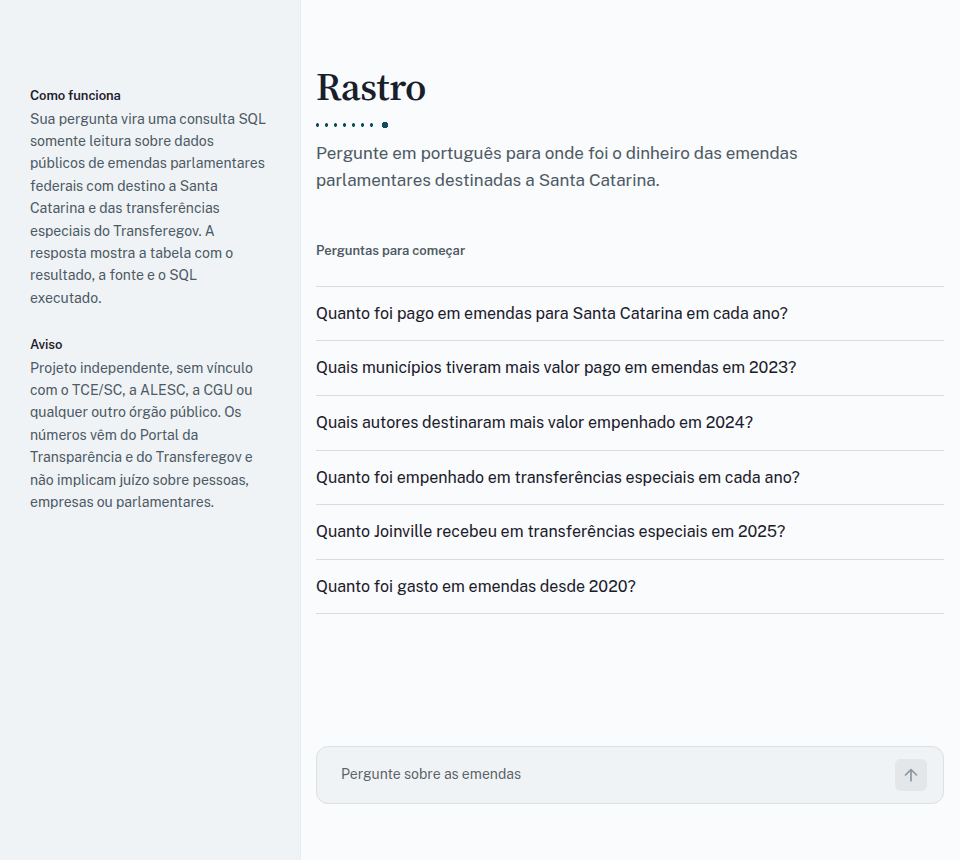

# Rastro

Pergunte em português para onde foi o dinheiro das emendas parlamentares destinadas a Santa Catarina.

[](https://github.com/gvheisler/rastro/actions/workflows/ci.yml)
[](LICENSE)
[](pyproject.toml)



O Rastro carrega dados públicos de emendas parlamentares em um banco Postgres e usa um agente de IA para transformar perguntas em português em consultas SQL somente leitura. Cada resposta mostra o texto, a tabela com o resultado, a fonte e o SQL executado, para que qualquer número possa ser conferido.

> [!NOTE]
> Projeto de portfólio, ainda em andamento. Os resultados não foram validados: as respostas podem estar erradas e os dados, incompletos. Não use os números sem conferir nas fontes oficiais. Detalhes em [Limitações](#limitações).

## Índice

- [Por que existe](#por-que-existe)
- [Início rápido](#início-rápido)
- [Configuração](#configuração)
- [Modelo de linguagem](#modelo-de-linguagem)
- [Como o agente responde](#como-o-agente-responde)
- [Dados](#dados)
- [Limitações](#limitações)
- [Desenvolvimento](#desenvolvimento)
- [Aviso](#aviso)
- [Licença](#licença)

## Por que existe

Os dados de emendas parlamentares são públicos, mas chegam em arquivos grandes, com várias tabelas ligadas por código, formatos antigos e campos sem padrão. Responder uma pergunta simples, como "quanto foi pago em emendas para Santa Catarina em 2025?", exige conhecer a estrutura dos dados e escrever consultas. O Rastro faz essa parte e deixa a consulta à vista.

## Início rápido

Requisitos: Docker, [uv](https://docs.astral.sh/uv/), Python 3.12 e um modelo de linguagem. O padrão é o [Ollama](https://ollama.com) local com o `qwen3:8b` (`ollama pull qwen3:8b`); para usar a API do Claude ou outro serviço, veja [Modelo de linguagem](#modelo-de-linguagem).

```
make setup    # cria o .env, sobe o Postgres (porta 5433) e instala as dependências
make ingest   # baixa os dados federais, consulta o Transferegov e monta raw, staging e mart
make check    # checks de qualidade sobre o mart
make model    # cria o modelo rastro-sql no Ollama (só para o modelo local)
make app      # abre o chat em http://localhost:8501
```

Para perguntar pelo terminal:

```
uv run rastro ask "Quanto foi pago em emendas em 2024?"
```

`make ingest` pode ser repetido: cada execução recarrega as tabelas sem duplicar linhas. A consulta ao Transferegov leva alguns minutos; `uv run rastro ingest --skip-transferegov` reconstrói sem ela, com o que já está no banco. `make psql` abre um console no banco.

## Configuração

Tudo é lido do arquivo `.env`, criado a partir de [`.env.example`](.env.example) por `make setup`.

| Variável | Padrão | Para que serve |
| --- | --- | --- |
| `POSTGRES_USER`, `POSTGRES_PASSWORD`, `POSTGRES_DB`, `POSTGRES_HOST`, `POSTGRES_PORT` | `rastro`, sem padrão, `rastro`, `localhost`, `5433` | Banco usado pela carga dos dados. |
| `READONLY_USER`, `READONLY_PASSWORD` | `rastro_ro`, sem padrão | Usuário somente leitura com que o agente consulta. |
| `LLM_PROVIDER` | `openai` | `openai` para qualquer servidor compatível com a API de chat da OpenAI (Ollama, vLLM, OpenAI, OpenRouter, Groq); `anthropic` para a API do Claude. |
| `LLM_MODEL` | `rastro-sql` ou `claude-opus-5-5` | Nome do modelo. O padrão depende do provedor. |
| `LLM_BASE_URL` | `http://localhost:11434/v1` | Endereço do servidor. Com `anthropic`, só é usado se for alterado. |
| `LLM_API_KEY` | vazio | Chave do serviço. Com `anthropic`, `ANTHROPIC_API_KEY` também é aceita. |
| `LLM_EXTRA_BODY` | `{"reasoning_effort": "none"}` | JSON enviado em cada requisição do provedor `openai`. |
| `LLM_TEMPERATURE` | `0` | Temperatura do provedor `openai`. Vazio não envia o campo. |
| `LLM_EFFORT` | vazio | Esforço de raciocínio do Claude (`low`, `medium`, `high`, `xhigh`, `max`). Vazio usa o padrão do modelo. |
| `TRANSFEREGOV_BASE_URL` | API pública do Transferegov | Fonte das transferências especiais. |

## Modelo de linguagem

A qualidade das respostas depende do modelo. Trocar de modelo muda a qualidade, o tempo de resposta e os tipos de erro; as verificações descritas abaixo valem para qualquer modelo, mas não corrigem tudo. O modelo usado aparece no rodapé de cada resposta e em `logs/agent.jsonl`.

### Ollama local (padrão)

```
LLM_PROVIDER=openai
LLM_BASE_URL=http://localhost:11434/v1
LLM_MODEL=rastro-sql
```

`make model` cria o `rastro-sql` a partir do [`Modelfile`](Modelfile): o `qwen3:8b` com contexto de 8192 tokens, necessário porque o prompt com o esquema não cabe no contexto padrão do Ollama. É um modelo pequeno, que roda numa GPU de 8 GB com parte na CPU, e o prompt e as verificações foram ajustados para ele. O padrão de `LLM_EXTRA_BODY` desliga o raciocínio do qwen3; há modelos que não aceitam esse valor (o `gpt-oss` só aceita `low`, `medium` ou `high`).

### API do Claude

```
LLM_PROVIDER=anthropic
LLM_MODEL=claude-opus-5-5
ANTHROPIC_API_KEY=sua-chave
```

Usa o SDK oficial da Anthropic. `LLM_MODEL` aceita qualquer modelo da API, por exemplo `claude-sonnet-5-5` ou `claude-haiku-5-5`, mais baratos. O prompt de sistema é enviado com cache, o que reduz o custo das perguntas seguintes. Este provedor é coberto por testes automáticos com respostas simuladas e ainda não foi executado contra a API real.

### Outro serviço compatível com a OpenAI

```
LLM_PROVIDER=openai
LLM_BASE_URL=https://api.openai.com/v1
LLM_MODEL=nome-do-modelo
LLM_API_KEY=sua-chave
LLM_EXTRA_BODY={}
```

Vale para OpenAI, OpenRouter, Groq, vLLM e qualquer servidor que atenda `/chat/completions` com chamadas de ferramenta. Ajuste `LLM_EXTRA_BODY` ao que o serviço aceita e deixe `LLM_TEMPERATURE` vazio para modelos que rejeitam temperatura. Só o Ollama foi testado aqui.

### Outro provedor

Um provedor novo é uma classe com o atributo `model` e o método `complete(messages, tools)`, que devolve um `Completion` ([`src/rastro/agent/llm.py`](src/rastro/agent/llm.py)), mais um ramo em `build_llm`. O cliente do Claude em [`llm_anthropic.py`](src/rastro/agent/llm_anthropic.py) serve de exemplo.

## Como o agente responde

1. Uma triagem simples recusa, antes do modelo, pedidos para alterar dados, pedir CPF ou acusar pessoas.
2. O modelo recebe o esquema do `mart` e escolhe entre quatro ferramentas: `run_sql`, `find_values` (como um nome está escrito nos dados), `ask_clarification` e `refuse`.
3. Todo SQL passa pelo `sql_guard`: uma única instrução `SELECT`, só tabelas do `mart`, sem funções de sistema (como `pg_sleep` ou `current_setting`), `AND` e `OR` com parênteses e `LIMIT` de no máximo 200 linhas. A consulta roda com um usuário Postgres somente leitura e limite de 10 s.
4. Uma verificação sem modelo compara a consulta com a pergunta. Se a consulta filtra ano, tipo de localidade, tipo de emenda ou planos impedidos e a pergunta não cita isso, ou se combina valores diferentes (pago, empenhado, liquidado) sem a pergunta pedir, ela volta ao modelo uma vez com a explicação. Se o modelo insistir, a resposta sai com um aviso sobre o filtro ou, no caso dos valores, com o quadro dizendo quais usou.
5. Quando a pergunta deixa dúvida, o agente decide em vez de perguntar. Se o modelo pede esclarecimento, a primeira tentativa volta a ele para que escolha o padrão (valor pago, ano da emenda); só chega ao usuário a pergunta de um pedido sem nada para medir ou listar. A resposta traz o quadro "Como interpretei a pergunta", por exemplo "Você não disse qual valor queria; usei o valor pago" e "Considerei o ano da emenda no orçamento, não a data do pagamento". Essas frases são montadas pelo código a partir do SQL que rodou, e não escritas pelo modelo, para que não contradigam a consulta.
6. Enquanto o agente trabalha, o chat lista cada etapa (entender a pergunta, consultar o banco, escrever a resposta, conferir os números) com o tempo de cada uma, e a lista fica na resposta.
7. A resposta mostra o texto, a tabela com o resultado, a fonte e o SQL. Resultado vazio vira "não encontrei" e valores do texto que não aparecem no resultado são sinalizados.
8. Cada pergunta, SQL, tempo e modelo ficam em `logs/agent.jsonl`.

## Dados

- [Portal da Transparência (CGU): emendas parlamentares](https://portaldatransparencia.gov.br/download-de-dados/emendas-parlamentares)
- [Transferegov: API de dados abertos das transferências especiais](https://api-publica.transferegov.gestao.gov.br/especiais/docs)
- Painel do TCE/SC (Farol TCE): usado apenas para reconciliação dos valores.

Os dados passam por três camadas: `raw` guarda os CSVs do Portal da Transparência e as respostas da API do Transferegov (só Santa Catarina) como texto, exatamente como vieram; `staging` aplica tipos, trata valores ausentes e padroniza categorias; `mart` tem só Santa Catarina, com nomes em português e pessoas físicas sem nome.

As colunas de cada tabela estão em [`docs/data-dictionary.md`](docs/data-dictionary.md). Os arquivos de origem, a data do download e os checksums estão em [`data/README.md`](data/README.md).

## Limitações

- O agente pode errar. A consulta e a tabela acompanham cada resposta para que o erro apareça; confira o SQL antes de usar um número.
- Ainda não há avaliação com perguntas e gabarito, então não existe uma taxa de acerto medida para publicar.
- A reconciliação dos valores com o painel do TCE/SC ainda não foi feita.
- O provedor da API do Claude ainda não foi executado contra a API real, e a comparação entre o modelo local e o Claude está por fazer.
- O escopo é Santa Catarina: emendas federais do Portal da Transparência e transferências especiais do Transferegov.

## Desenvolvimento

```
make test    # testes (precisam do Postgres no ar: make up)
make lint    # ruff check e ruff format --check
make fmt     # corrige o que o ruff consegue
```

Estrutura do código:

| Caminho | Conteúdo |
| --- | --- |
| `sql/` | Definição das camadas `raw`, `staging` e `mart`. |
| `src/rastro/ingest/` | Carga dos CSVs federais e da API do Transferegov. |
| `src/rastro/quality/` | Checks de qualidade sobre o `mart`. |
| `src/rastro/agent/` | Agente: clientes de LLM, prompt, ferramentas, `sql_guard` e verificações. |
| `src/rastro/app/` | Chat em Streamlit. |
| `src/rastro/cli.py` | Comandos `rastro ingest`, `rastro check` e `rastro ask`. |
| `tests/` | Testes, com amostras dos dados em `tests/fixtures/`. |

Contribuições são bem-vindas. Abra uma issue descrevendo o problema ou a ideia antes de mudanças grandes; em um pull request, inclua testes para o que mudou e rode `make lint` e `make test`. `uv run pre-commit install` ativa o ruff a cada commit.

## Aviso

Projeto independente, sem vínculo com o TCE/SC, a ALESC, a CGU ou qualquer outro órgão público. Os números exibidos vêm das fontes acima e não implicam juízo sobre pessoas, empresas ou parlamentares.

## Licença

[MIT](LICENSE)
